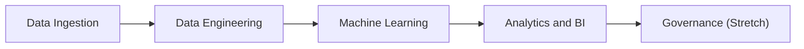

# Developer notes

# BIG FINDING: PUB WIPES ITS TELEGRAM CHANNEL FROM TIME TO TIME (AT LEAST 4 TIMES SINCE 2022). ON THE CHANNEL, EVERYTHING BEFORE 19 MARCH 2025 IS GONE EXCEPT 16 POSTS.
# THE INTERNET ARCHIVE HOLDS MOST OF IT: `backfill.py telegram-wayback` RECOVERS 832 OF THE 1,092 MISSING POSTS (NOVEMBER 2021 TO MARCH 2025).
# ON 14 NOVEMBER 2023 THE CHANNEL MOVED FROM t.me/sgflood TO t.me/pubfloodalerts, TITLED "Gov.sg-PUB Flood Alerts" UNTIL 3 APRIL 2024. POST IDS DID NOT CHANGE.
# LOST FOR GOOD: FEBRUARY TO ~AUGUST 2024 (IDS 766-894) AND 5-19 OCTOBER 2024 (IDS 927-955) WERE WIPED BEFORE THE ARCHIVE CAPTURED THEM.

## Developer Checklist

Round 2 is a mentored build sprint from 12 to 26 Oct 2026. Demo Day is on 27 Oct, 4–7pm SGT, and picks the top 3; the finale is on 4 Nov ([DAISI guide](https://daisi.online/guide)). Demo Day is scored on social impact (30%), technical execution on Databricks (30%), solution and user experience (20%), data rigour (10%) and presentation (10%). B2's "winning demo" list asks for:

- a Low/Medium/High classifier by zone;
- a live risk dashboard that updates as rain streams in;
- a three-year trend of flood-prone areas;
- both batch data (training) and streaming data (inference).

Tags follow the Round 1 plan: **W1** is due Sun 18 Oct, **W2** is due Sun 25 Oct, and **Stretch** waits until both are done. Ticked boxes were checked against the repo and the dev deploy on 13 Oct, the silver ones on 14 Oct (`uv run pytest`: 115 passed), and the gold and ML ones on 15 Oct (160 passed). An unticked box is either not done or still needs checking in the workspace.

### Data Ingestion

The bronze fetchers are written, tested and deployed to dev (see [Ingestion (bronze)](#ingestion-bronze)). What's left is running them to completion, plus the label work.

- [ ] Flash Floods
    - [ ] PUB Flood Alerts Telegram fully extracted for backfill **W1**
        - [x] `backfill.py telegram` pages back with `?before=` to the oldest visible post and lands one file under `pub_telegram_posts/archive/`.
        - [x] Archive landed in dev and visible in `bronze.pub_telegram_posts` (`source_file LIKE '%/archive/%'`): both scrapes, 10 Oct (522 of ids 1–1631) and 13 Oct (524 of ids 1–1633).
        - [ ] Record the missing ids at scrape time. The run summary's `posts_by_year` is a quick check.
        - [x] Counts match the 12 Oct label census (checked in `silver.telegram_posts`, 14 Oct). 2026: 120 warnings on 35 days and 8 flash floods on 6 days, exactly. Mar–Dec 2025: 137 warning posts on 44 days and 18 flash floods on 8 days (the census, 134 on 43 and 21 on 11, also counted older posts still on the channel).
        - [x] Posts PUB deleted, recovered from web archive captures with `backfill.py telegram-wayback` (13 Oct, locally into `.landing-dev`): 872 post ids from 93 captures in 12 minutes, including 832 of the 1,092 ids the channel no longer shows. By keyword, that adds about 435 "Risk of Flash Floods" warnings and 14 flash floods on 11 days (Nov 2021 to Mar 2025) to a training set of 21 floods.
            - [x] Landed in dev on 14 Oct: `bronze.pub_telegram_posts` holds 1,356 distinct ids of 1–1633 (wayback 872, archive 524, live 20).
            - [x] Label census with them (`silver.telegram_posts`, 14 Oct): before Mar 2025, 435 warning posts (555 locations) on 121 days and 16 flash-flood posts (17 locations) on 12 days.
            - [x] Decide whether training can start before Mar 2025: yes (15 Oct). Labels run from 27 Oct 2021, with the time posts were never recovered marked missing rather than quiet (`gold.label_ticks`), and the split is 80/20 of the recorded time (see [Gold](#gold)).
    - [ ] PUB Flood Alerts Telegram Live Ingestion fully functional **W1**
        - [x] `flood-live` lands posts newer than the cursor in `_state/telegram.json`, so it keeps posts that PUB later deletes.
        - [ ] Unpause `flood-live` in dev (the 10 Oct deploy left it paused). Then check that the cursor advances and that `pub_telegram_posts` reports `ok` in `bronze.ingest_heartbeat`.
        - [ ] Catch up after an outage. A tick reads only the newest page (about 20 posts), so after a gap, such as a day of exhausted quota, the posts in between are missed until the archive is re-run (if PUB hasn't deleted them by then). When the page doesn't reach back to the cursor, page back with `?before=` until it does.
        - [ ] Capture edits. Posts at or below the cursor are never landed again, so a later edit by PUB is missed. Keep text hashes of the newest page's posts in the cursor, and land a post again when its hash changes. Silver keeps the latest version.
    - [ ] PUB Flood Alerts Telegram Live Ingestion, Laya fallback for pattern matching failure, complete with warnings to the developer
        - [x] Categories: `warning` (Risk of Flash Floods, the 90% drain-level warning), `flash_flood`, `flood_subsided`, `heavy_rain`, `heavy_rain_eased` and `not_relevant`, plus `unmatched` for a post no pattern fits. **W1**
        - [x] Regex patterns for every category, one per format PUB has used (10 formats since Nov 2021), in `labels/alert_text.py`, which silver uses and a fetcher can import. Tested on 38 real posts in `tests/fixtures/pub_telegram_texts.jsonl`, including the drift found: 18 stamp spellings (`[14:13hours]`, `(Issued 11:00 hrs)`, `Issued 1510 hours`, `[Issued by NEA, 15: 30 hours]`, ...), a bullet left out (id 424), a doubled stamp (id 89), `[Risk of Flash Flood]` singular (id 1374), a window ending at 24:00 (id 323). **W1**
        - [x] Coverage report over the whole archive: `uv run python -m daisi_team_master_corgis_floodsense.labels.coverage .landing-dev/pub_telegram_posts`. Of 1,356 posts, all but 6 match a format; those 6 are announcements (scam advisories, the OBU announcement, a monsoon advisory, tips), labelled `not_relevant` in `data/static/telegram_manual_labels.csv`. **W1**
        - [x] Heavy Rain Warning and Heavy Rain Eased: detected by pattern (with their regions, window and NEA stamp in `silver.telegram_posts`) and kept out of `silver.area_alerts`. **W1**
        - [ ] [Laya](https://huggingface.co/convaiinnovations/laya), for posts no pattern matches: one `choice` question over the six categories, which returns a label and a `confidence`. **W2**
            - [ ] Validate it before trusting it. Run it on the posts the patterns already label and measure accuracy per category. Refit its temperature, since the model card says the shipped checkpoints are over-confident. Then set a `confidence` cut-off below which a post goes to hand review.
            - [ ] Laya returns a category, not text. A post it classifies still needs its location and time from the gazetteer and the stamp regex; if those fail too, the post goes to the hand-check queue.
            - [ ] Keep it out of the 5-minute fetch path:
                - [ ] Load Laya only when a post fails every pattern; the checkpoint is about 808 MB and takes about 7 s to load on CPU.
                - [ ] Cache the checkpoint in a UC volume.
                - [ ] Add `huggingface.co` to `probe_egress.py`.
                - [ ] Consider a separate `flood-live` task that runs only when the fetch reports unmatched posts.
            - [ ] Call Laya once per post. Land each verdict in its own folder (for example `landing/pub_telegram_fallback/`, keyed by `message_id` and text hash), so re-runs and full refreshes reuse it and silver stays deterministic.
        - [ ] Warn the developer on every fallback, with what's needed to write the missing pattern **W2**:
            - [ ] message id, t.me link, posting time and full text;
            - [ ] Laya's label and confidence, and the runner-up;
            - [ ] the closest pattern and the part of it that failed (for example, the header matched but there was no stamp);
            - [ ] a suggested pattern skeleton (header escaped, digits and times generalised), the file it goes in and the fixture to add;
            - [ ] delivery beyond the log: a `WARNING` line, a `fallbacks` count in the heartbeat, and an email (a job notification, or a SQL alert on the warnings table).
            - [ ] Once the pattern exists, silver reclassifies the post by pattern on its next refresh; the Laya verdict stays for audit.
    - [ ] PUB flood-alerts API (flash floods only, with lat/lon circles) **W1**
        - [x] Live ticks, and `api-days` from 2025-09-01. Real records start around Oct 2025.
        - [ ] Day backfill finished. The 10 Oct laptop run reached 2026-01-10 and stopped (see the next block).
        - [x] Check which alert kinds and statuses it returns, and how a record repeats while an alert stays active, so silver counts each alert once. Up to 2026-01-10 it holds 68,541 two-minute records, of which 6 carry an alert (3 floods and their 3 "subsided" notices, on 4 and 12 Dec 2025), all headlined "Flash Flood Alert"; only the description tells a flood from its end. A record comes back on every tick until it scrolls off the newest page, so silver keeps one per issue time and description.
- [ ] Weather time series: rainfall, 2-hour forecast, wind direction and speed, lightning, air temperature, relative humidity, radar
    - [x] Fetchers: live ticks and day backfill for all nine API sources, and yearly CSVs for the six that have them.
    - [ ] Restart the laptop `api-days` backfill with an API key **W1**:
        - [ ] Register a data.gov.sg key and store it in the `floodsense` secret scope (see [One-time setup](#one-time-setup)). On 15 Oct the scope held a `datagovsg-api-key` stored on 12 Oct that data.gov.sg doesn't recognise: `check_key.py` measured 6 calls per 10 s, the no-key limit. Store the new key, then check it.
        - [x] Laptop runs read the key from the secret scope too (through `--profile`), and `check_key.py` measures which tier a key really gets.
        - [ ] The 10 Oct run had no key (`rate tier: none`) and stopped at 22:59 on `pub_flood_alerts` 2026-01-10. On 15 Oct a laptop run restarted rainfall and the forecast only (`--sources nea_rainfall nea_two_hr_forecast`, no key), from 2025-01-01, at about 40 s per day of rainfall. It was stopped after 2025-06-30, to resume with a key (log: `~/floodsense-api-days.log`). Until they do and `flood-etl` streams them, gold has no rain from 2025 on: none in the test split, and none in the last year of training. `pub_flood_alerts` from 2026-01-11 is still to do.
        - [ ] It resumes where it stopped. With a dev key, labels, rainfall and the forecast land in about 8 hours, and everything in about 3 days.
    - [ ] Run the `hist_csv` task of `flood-backfill` (2021–2024). Re-run it when data.gov.sg publishes 2025. **W1**
    - [ ] Check coverage per source and day with the progress query in [Checking it](#checking-it). Rainfall must cover every day from the training start, 2021-10-27 (the CSVs cover 2021–2024; the API backfill the rest). **W1**
    - [ ] Unpause `flood-daily`, so each night repairs gaps in the live feed. **W1**
    - [ ] Radar starts on 2026-07-01, so a model trained on 2025 can't use it: archive it only for now (**Stretch**). Lightning starts on 2025-02-01, so it covers training.
- [ ] Tides
    - [x] NEA tide table, scraped daily (this month and next); UHSLC Tanjong Pagar hourly, 1984–2023.
    - [ ] Run the `uhslc` task, then check its row count and the `-32767` gaps. **W1** Landed locally on 20 Oct: 350,632 hours (1984-01-01 to 2023-12-31 15:00 GMT), 12,386 of them `-32767`, almost all before 2016.
- [ ] Static layers
    - [x] `fetch_static.py`: URA MP2019 and MP2025 land use, PUB water-level sensors, flood-prone area (ha), SLA vertical-control benchmarks.
    - [ ] Run the `static` task, and confirm each `static_*` table holds one `version`. **W1**
    - [ ] PUB list of flood-prone areas (Apr 2025 PDF, 36 names): transcribe it to a CSV seed in `data/static/`. Silver geocodes it. **W1**
    - [ ] NEA's 47 forecast areas and their label points come with the 2-hour forecast (`area_metadata`), so silver builds them; there's nothing extra to ingest.
    - [ ] Elevation: choose the SLA benchmarks (points, already landed) or the Copernicus GLO-30 DEM (30 m raster; registration and an attribution notice required). GLO-30 is a one-off download from a laptop into a UC volume. **W2**
    - [ ] PUB drainage catchment maps: PDF only, so the 11 catchments have to be digitised by hand. Only upstream-catchment rainfall needs them. **Stretch**
- [ ] **Stretch:** LTA DataMall, for B2's ridership-disruption stretch goal. It needs an account key; first check what it offers at the time resolution of a storm.

### Data Engineering

Silver goes in the `flood-etl` pipeline and gold in `flood-gold`, under `src/pipeline/transformations/{silver,gold}/`. Build them backwards from `ml/contract.py`. All timestamps are SGT.

Silver is built (14 Oct) up to the labels and the two core feature sources; see [Silver](#silver). What's left there is the area polygons, the weather and tide tables, and the area context.

- [ ] Silver: reference tables **W1**
    - [x] `silver.forecast_areas`: the 47 areas and their label points, from `area_metadata` and the yearly CSVs. 47 rows.
    - [ ] Polygons for the app's map: Voronoi cells around the label points, clipped to the coastline (the union of the Master Plan land-use polygons works as one). Alerts don't need them: the nearest label point is the Voronoi cell.
    - [x] `silver.rain_stations`: the rain gauges, with location and first and last day seen: 104 ids (89 in the API's list on 10 Oct, 80 in the 2021–2024 CSVs). None has moved; some were renamed.
    - [ ] Weather stations, with `silver.weather_5min`. **W2**
- [ ] Silver: readings
    - [x] `silver.rainfall_5min` (station, ts, mm), from live, backfill and yearly CSVs **W1**:
        - [x] explode `payload:body.data.readings` and cast;
        - [x] keep `status = 200` pages only (404 and empty pages are day markers);
        - [x] deduplicate on (station, ts), keeping the latest `fetched_at` (Auto CDC, so each update merges only new pages);
        - [x] expectations: a parsed reading, 0 ≤ mm ≤ 60 (the 2021–2024 maximum is 37.2 mm). All 27,329,166 readings passed.
        - [x] `published_at`: when NEA published each reading, from the CSVs. Gold needs it (see the reading-lag item below).
    - [ ] `silver.weather_5min`: air temperature, humidity, wind speed and wind direction, from 1-minute readings to 5-minute means. Average the wind as u/v components. **W2**
    - [x] `silver.forecasts_2h` (area, issued at, published at, valid window, category), with NEA's code and an ordinal `rain_class` (0–5) for the categories. Joins use only forecasts with `updated_at` before the tick. 4,140,371 rows, every category known.
    - [x] Tides (20 Oct; see [Tides](#tides)): `silver.tide_gauge_hourly` and `silver.tide_extremes` clean the two sources, and gold models and imputes:
        - [x] `gold.tide_model`: utide fitted on UHSLC 2005–2023, constituents kept.
        - [x] `gold.tide_levels`: a tide at every 5-minute tick, 2021 through next year, imputed from the prediction wherever the gauge is silent.
        - [x] `gold.tide_datum`: the datum offset against NEA's high and low waters (−0.005 m), with expectations at 0.15 m and 30 min (worst seen: 0.11 m and 19 min).
- [ ] Silver: labels **W1**
    - [x] `silver.telegram_posts`: one row per `message_id`, archive, wayback and live merged, latest version kept. Columns: category, method (`pattern` or `manual`; `laya` later), pattern, problem, hint, and the locations with their stamps.
        - [x] Stamp to datetime: the posting date, minus a day when the stamp is more than 10 minutes after the posting (posts just after midnight, e.g. ids 1122 and 1290).
        - [x] A post that names several locations becomes one alert per location (855 from 734 alert posts).
        - [x] `silver.telegram_review`: posts no pattern matches, or matched with a problem, each with the action that resolves it.
    - [x] `silver.api_flood_alerts`: issue time, category (read from the description), location, `alert_ts` from its stamp, circle centre and radius.
    - [ ] `silver.location_gazetteer` (normalised location text → lat/lon → area, method):
        - [x] Hand fixes first (`data/static/location_gazetteer_manual.csv`), then PUB's own circle from the API, then the water-level sensor of the same name (SVY21 converted to WGS84; a name match of at least 0.8, since lower scores land on the wrong stretch of long roads), then OneMap.
        - [x] OneMap search: `backfill.py onemap`, on a laptop. Without a token OneMap answers about one search every 10 s: 317 locations took about 2 hours over two runs (15 Oct). An answer counts only if its road, name or building is the place searched (OneMap's top answer for "Kings Rd" is a building on Joo Chiat Road). A re-run asks only what hasn't been asked.
        - [x] Misses go to `silver.alerts_unplaced`, with the best-named sensor as a hint (the Round 1 risk plan).
        - [x] Report the share geocoded by each method (query in [Checking it](#checking-it-1)); it's a data-rigour point for the judges. 15 Oct, after OneMap: of 858 alerts, OneMap placed 511 (60%), PUB's sensor names 290 (34%), PUB's API circles 7 (1%); 50 (6%, all warnings, at 29 locations) wait in `silver.alerts_unplaced`.
        - [ ] Hand-place the 29 unplaced locations in `data/static/location_gazetteer_manual.csv`: they blank their storm hours for every area (see [Gold](#gold)).
        - [ ] Hand-check the gazetteer, starting with the rows where OneMap disagrees with the chosen point (`onemap_km`).
    - [x] `silver.area_alerts`, exactly as `contract.AREA_ALERTS_COLUMNS` defines it, with the contract's descriptions as column comments:
        - [x] An API flood that is a Telegram post's alert (same kind, stamped within 15 minutes, named alike) becomes one row, with the Telegram stamp as `alert_ts`.
        - [x] Expectations: area not null (otherwise `silver.alerts_unplaced`), and kind is `warning` or `flash_flood`.
        - [x] Subsided and heavy-rain posts stay out.
    - [ ] Geocode the 36 flood-prone names with the same gazetteer (after transcribing them, see Static layers).
- [ ] Silver: area context **W2**
    - [ ] `silver.area_static`, one row per area:
        - [ ] land-use shares (MP2019 before 1 Dec 2025, MP2025 after);
        - [ ] elevation summary (min, mean, share of low-lying cells);
        - [ ] number of water-level sensors;
        - [ ] number of flood-prone locations.
- [ ] Gold (`flood-gold`, built 15 Oct; see [Gold](#gold))
    - [x] `gold.area_features`: area × 5-minute tick, point-in-time. 18.0 million rows (2021–2024, and a live tick), every expectation passed.
        - [x] Contract columns: `rain_{15,30,60}min_mm`, the largest total among gauges within 5 km (`gold.area_rain_stations`: 493 pairs, every area has one), plus `rain_gauges`. The rule baseline needs only these. **W1**
        - [x] The reading lag, measured on the CSVs (`silver.rainfall_5min.published_at - ts`): NEA published every 2021–2024 reading more than 5 minutes after its timestamp, and 4–20% of rain readings more than 10 minutes after. So `READING_LAG_MINUTES` is now 10, and a reading also waits for its `published_at` where the CSVs give one. Checked against a hand recomputation from silver on five area-ticks: equal. **W1**
        - [ ] Measure the lag again from live ticks once `flood-live` runs (2025 on has no publish time). **W1**
        - [x] The 2-hour forecast: `forecast_rain_class` (0–5) and `forecast_age_min`, from the newest forecast published by the tick while it is valid (`gold.area_forecasts`). Checked against a hand recomputation from silver on 1,827 random area-ticks: equal. A third of the training ticks an alert followed had no rain within 5 km yet, and the forecast is what tells them from a quiet afternoon (see [Gold](#missing-features-versus-dry-ones)). **W1**
    - [x] `gold.feature_ticks`: per tick, whether the features are known. Missing when the gauge network didn't report at every reading timestamp the rain windows read, or no forecast was valid. An outage leaves no `area_features` row, which must not read as a dry tick. **W1**
    - [x] Labels: `gold.label_coverage` (id gaps as intervals), `gold.label_ticks` (per tick: recorded or missing, why, and the split) and `gold.area_labels` (per area and tick: `alert`, `no_alert` or `missing`, and 1/0/null labels for alerts and floods). **W1**
    - [x] The 80/20 temporal split on recorded label time: train 27 Oct 2021 – 18 Dec 2025, a day's embargo, test 20 Dec 2025 – 12 Oct 2026 (`contract.TEST_START`, computed by `split.temporal_split`). **W1**
    - [x] `gold.model_rows`: the only rows models learn from or are tested on, where both the label window and the feature window are recorded. Expectations fail the update if a missing interval gets in. **W1**
        - [ ] Columns for the gated model **W2**:
            - [ ] antecedent rain (3 h, 24 h) and rain trend;
            - [ ] upwind rain, using the wind vector;
            - [x] forecast category and its age (15 Oct);
            - [x] tide height and minutes to the next high tide (20 Oct; the predicted tide, see [Tides](#tides));
            - [ ] temperature and humidity;
            - [ ] the `silver.area_static` columns.
            - [ ] Per-area history, such as the past alert rate, is computed on the training window only.
        - [ ] Live/backfill parity: rebuild a live day from backfill files and compare. Replay is only honest if the two match. **W2**
    - [ ] `gold.flood_prone_trend` (year and hectares: 27 ha in 2022 down to 23.3 ha in 2025) and `gold.flood_prone_locations` (the 36 geocoded names). **W1**
    - [ ] `gold.pub_lead_times`: minutes from PUB's first alert to each flash flood in the archive, to re-measure the 13.3-minute figure as Round 1 promised. `scoreboard.alert_events` already finds the first alert and first flood per event. **W1**
- [ ] Pipeline health
    - [ ] A `flood-etl` update has to finish well inside the 5-minute tick. Time it after adding each table, and move heavy rebuilds to `flood-daily` if it doesn't fit. **W1** The first silver build, including the one-off load of 27 million CSV readings, took 4.5 minutes on 14 Oct. A later update with no new readings took about 5 minutes: 2 waiting for and starting serverless compute, and 2.5 running, mostly the label tables (the gazetteer's sensor matching about 30 s, each Python-UDF table a few seconds to start its workers). That leaves no room in a 5-minute tick; options are a separate labels pipeline that `flood-live` refreshes only when new posts land, or a 10-minute cadence. Decide once gold is in.
    - [x] Tests: stamp, location and alert parsers against fixtures, plus contract tests that silver's and gold's columns match `contract.py` (`tests/test_silver_contract.py`, `tests/test_gold_contract.py`). **W1**
    - [x] Gold in its own pipeline, so the 5-minute `flood-etl` updates don't rebuild years of features: the first `flood-gold` build took about 1.5 minutes of running (3.5 with compute start-up). `flood-daily` refreshes it after the repair. Live scoring will need the newest tick's features within the tick: compute them from silver with the same definitions, or refresh `flood-gold` in `flood-live` if its updates stay short.
    - [ ] Feed expectation pass rates from the pipeline event log to the dashboard's health page. **W2**

### Machine Learning

`src/daisi_team_master_corgis_floodsense/ml/` holds the contract, scoreboard, rule baseline, time split, the gated LightGBM pair (`gated.py`) and the training job (`train.py`). Every model learns from `gold.model_rows`, is judged by `scoreboard.score` against `silver.area_alerts`, and writes `ml.predictions`. See [Machine learning](#machine-learning-1).

- [x] `contract.py`: 47 areas, 5-minute ticks, 60-minute horizon, a 10-minute reading lag, labels from 27 Oct 2021, the 80/20 split (test from 20 Dec 2025 to 13 Oct 2026), the gold label and feature-coverage tables, and `model_rows`.
- [x] `scoreboard.py`: events, episodes, lead time, false alarms per area-month, High precision, and 95% CIs (Wilson, and a bootstrap over days). `missing=` (the missing ticks of `gold.label_ticks`) and `blind=` (those of `gold.feature_ticks`) leave out what can't be judged, and count it in `*_unjudged`.
- [x] `baseline.py`: fits the rule's window and its Medium and High thresholds on the training window, honouring `missing=` and `blind=`.
    - [x] Smoke test on gold, 15 Oct, after geocoding (train split where gold had rain: 27 Oct 2021 – 22 May 2025, as far as the backfill had reached). Medium from `rain_15min_mm` ≥ 17.5, never High: 10.8% of 240 judged alert events flagged before PUB (95% CI 7.5–15.4%), 1.8 min mean lead, 0.83 false alarms per area-month. 160 events were unjudged: 114 next to id gaps (PUB deletes posts mostly during storms), the rest next to the 50 unplaced warnings. Not the real fit yet: that waits for the 2025 rain.
- [x] `split.py`: `temporal_split` (the 80/20 cut on recorded ticks), 5 blocked day-folds in the development period, a 1-day embargo, and the test kept for a single run.
- [ ] Setup **W1**
    - [x] `lightgbm` and `scikit-learn` in `pyproject.toml`; the training job adds `lightgbm` to serverless environment 6, which has scikit-learn and `mlflow-skinny`. `utide` is in `pyproject.toml` and in `flood-gold`'s environment (20 Oct). Still to add for silver: `pyproj` and `shapely`.
    - [x] `resources/train.job.yml` (`flood-train`) and `resources/ml.yml` (the MLflow experiment and the UC registered model), deployed to dev on 15 Oct.
    - [x] Every run logs `split.summary(...)`, and the coverage of each split.
- [ ] Rule baseline end to end **W1**
    - [x] `flood-train` fits it on the development period and logs its parameters, scoreboard metrics and threshold curve to MLflow, next to the pair.
    - [ ] Write its predictions to `ml.predictions`. `flood-train` writes them for the test split when it scores it (`score_test=true`); live predictions come with the `score` task.
    - [ ] Add a `score` task to `flood-live`, after `refresh_pipeline`, that scores the newest tick for all 47 areas. The app then runs on the rule in Week 1.
- [ ] Gated LightGBM pair **W2** (`ml/gated.py`, trained by `flood-train`; first trained 15 Oct on the training time gold could use then, Nov 2021 – Dec 2024)
    - [x] Gate: a LightGBM, not a rain threshold. A third of the training ticks an alert followed had no rain within 5 km yet, so any rain threshold drops the early ticks that give lead time; the gate reads the forecast and the hour too. It trains on every recorded tick (quiet ones subsampled to 5% and weighted back up), and its out-of-fold scores set its threshold: the highest that passes 90% of alert ticks. 15 Oct: it passes 12% of area-ticks and leaves 90% of PUB events catchable. The job tries gate recalls 0.85, 0.9 and 0.95, and the scoreboard picks one.
    - [x] Rater: LightGBM on the ticks the out-of-fold gate passed.
        - [x] Label: `gold.area_labels.alert_label` (what `scoreboard.tick_labels` computes), any PUB alert within 60 minutes. The 90% warnings train the Medium tier.
        - [x] Cross-validated with `split.cv(...)` and early stopping on the mean out-of-fold loss. No hyperparameter search yet.
        - [x] Monotone constraints: the alert chance never falls as rain or the forecast class rises.
    - [x] Calibration: centered isotonic regression on the pooled out-of-fold scores (plain isotonic gave thousands of storm ticks one probability, so a cut-off couldn't fall between them). The reliability table and Brier score are logged.
    - [x] Tier cut-offs, from the same pooled predictions:
        - [x] Medium: the most PUB events flagged before PUB, within no more false alarms than the rule raises (at most 1 per area-month);
        - [x] High: where at least 1 in 3 High episodes are followed by a flash flood (the same logic as `baseline.fit`). 15 Oct: never, as one flood event could be judged; the 2025 floods arrive with the backfill.
    - [x] Reasons: LightGBM's `pred_contrib=True`, the two inputs that raised the score most, in plain English ("19 mm of rain within 5 km in the last 15 min; NEA forecasts thundery showers here"). Upwind rain and tides join when those columns exist.
    - [x] Before touching 2026, beat the rule on both lead time and false alarms out of fold, as committed in Round 1. 15 Oct: 20.8% of 192 judged alert events flagged before PUB (95% CI 15.7–27.1%) against the rule's 9.4% (6.0–14.3%), 5.1 min mean lead against 0.9, at 0.87 false alarms per area-month against 0.91. Registered as version 2, `@champion`. Refit once the backfill lands: 2025 holds a third of the training time.
- [ ] Held-out test, run once **W2**
    - [ ] Score 2026 to date: `databricks bundle run train -t dev -p flood_dev --params score_test=true`, once the API backfill has landed rain and forecasts through 12 Oct 2026 and `flood-etl` and `flood-gold` have run. It refuses while under 95% of the test's recorded label time has features (0% on 15 Oct).
    - [x] Log the event-by-event table and the metrics with 95% CIs for the pair and the rule (PUB's own warning time is in `*_mean_pub_warning_min`), and write the test predictions to `ml.predictions`. Scoreboard tables for the dashboard are still to do.
        - [x] The write, dry-run on serverless on 15 Oct (Databricks Connect, synthetic predictions into a scratch table, then dropped): one row per model and tick, `p_alert` NULL for the rule, SGT times unshifted, the contract's column comments, clustered by `(model, ts)`; a rerun keeps the other models' rows and replaces its own. `score_test` writes the predictions before it logs any test metric, so a failed write leaves the test unseen.
    - [ ] State the power caveat. The test has 8 floods, so even 8/8 gives a Wilson interval of 0.68–1.00, and the ">80% of floods flagged" target can't be confirmed on them alone. The alert-level metrics (120 warnings on 35 days) are the ones with usable CIs.
- [ ] Register and serve **W2**
    - [x] One pyfunc (`ml/serving.py`) holds the gate, rater, calibrator, cut-offs and reasons. Registered in UC as `<catalog>.<ml schema>.floodsense` (dev: `flood_dev.dev_stkinzheng_ml.dev_stkinzheng_floodsense`): every version `@challenger`, and `@champion` when it beats the rule out of fold.
    - [ ] Register the rule too, as the comparison.
    - [ ] Switch the `flood-live` `score` task to `@champion`. It scores inside the job, with no serving endpoint (Free Edition limits those), and appends `model, area, ts, tier, p_alert, reason`. Cast the feature columns to double first: the model's signature refuses int64.
    - [ ] Live scorekeeping: a daily task scores every live prediction against the alerts that followed, the "keeps score in public" promise.
    - [ ] Storm replay: batch-score one flash-flood day from 22–30 Sep 2026 at every tick, and record how many minutes before PUB's first alert its area turned Medium.
- [ ] **Stretch:** a separate flash-flood model for High; sea-level-rise scenarios (re-score with tide offsets); upstream-catchment rainfall; radar and lightning features.

### Analytics and BI

`resources/app.yml`, `dashboard.yml` and `genie.yml`, `src/app/` and `src/dashboards/` are all still empty.

- [ ] FloodSense app (a Databricks App, for residents)
    - [ ] Choose the framework (AppKit, or Python if the team prefers) and deploy a stub to the final demo workspace early, as the guide advises. **W1**
    - [ ] Map of the 47 areas, coloured by tier from the newest `ml.predictions`, running on the rule baseline. **W1**
    - [ ] Area panel: tier, `p_alert`, the reason, and actions for drivers, residents and shop owners (fixed templates per tier and audience). **W2**
    - [ ] Live mode: refreshes every 5 minutes and shows data freshness from `bronze.ingest_heartbeat`. **W2**
    - [ ] Replay mode: pick a storm, play it tick by tick, and mark PUB's first alert and the moment the area turned Medium. **W2**
    - [ ] Scoreboard view, plus a line saying FloodSense is an earlier layer on top of PUB's alerts, not a replacement. **W2**
    - [ ] Works on a phone. **W2**
- [ ] AI/BI dashboard (for agencies)
    - [ ] Flood-prone trend panel (`gold.flood_prone_trend`, 2022–2025), with the 36 listed locations on a map. **W1**
    - [ ] PUB's re-measured warning time (`gold.pub_lead_times`) against the 30-minute target. **W1**
    - [ ] Scoreboard for the model, the rule and PUB: lead time, floods flagged before PUB, High precision, and false alarms per area-month, each with its CI. **W2**
    - [ ] Pipeline health: freshness per source, expectation pass rates, and geocoding misses awaiting review. **W2**
- [ ] Genie space **W2**
    - [ ] Tables `silver.area_alerts`, `ml.predictions` and the scoreboard tables, with descriptions, instructions and sample SQL.
    - [ ] Test the exact demo question in advance (e.g. "Which areas had the most false alarms last month?") and keep a screenshot of the answer.
- [ ] **Stretch:** Telegram push alerts, or a hand-off to PUB's channel.

### Governance (Stretch)

- [ ] Replace the "Placeholder" comments in `resources/uc.yml`, and give silver, gold and ml columns the descriptions in `contract.py`.
- [ ] Lineage screenshot for the deck: landing volume → bronze → silver → gold → model → `ml.predictions` → app and dashboard.
- [ ] Grants: the app's service principal and Genie users read `gold` and `ml` only. Restrict the `floodsense` secret scope.
- [ ] Model governance: a UC model description, tags (training window, test metrics), the training table logged as an MLflow input, and `@champion` moved only after a scoreboard check.
- [ ] Prod target: create the deploy service principal and run its grant in `setup/bootstrap.sql`. Remove `trigger_pause_status: PAUSED` once ingestion runs there.
- [ ] Attribution in table comments and the README: data.gov.sg (Singapore Open Data Licence), NEA, PUB, URA, SLA, UHSLC, OneMap, Copernicus (if GLO-30 is used) and Laya (Apache 2.0).

### Demo Day (27 Oct, 4–7pm SGT)

- [ ] Ask our mentor what the Round 2 submission must contain and when it's due. The guide only says "before Demo Day".
- [ ] Commit and push the ingestion and ML code, which was still untracked on 13 Oct. Update the README (results, architecture, how to run) and the `pyproject.toml` description. Make the repo accessible to the judges.
- [ ] Choose the final demo workspace and target. Dev names carry a `[dev …]` prefix, and dev deploys leave schedules paused.
- [ ] Quota:
    - [ ] Keep `live_schedule` at 15 minutes outside demo windows.
    - [ ] Run no backfills or full refreshes on 26–27 Oct; going over the daily quota stops compute for the rest of the day.
- [ ] Restart the app within 24 hours of the demo (Free Edition stops apps after 24 hours). Check that the SQL warehouse, pipeline and data are ready, and walk the main journey from a fresh browser session.
- [ ] Keep recordings or screenshots of the steps most likely to fail: live mode, Genie and the replay.
- [ ] No tokens, keys or personal data on screen. Tell the judges what isn't live: the precomputed replay, labels classified by Laya or fixed by hand, and prototype features.
- [ ] Rehearse the story and the presenter handoffs by 25 Oct: problem (13.3 min) → users → architecture (batch backfill for training, streaming ticks for inference) → replay → live → scoreboard → Genie → impact (minutes gained over PUB per 2026 flood, with CIs). Prepare answers on the 8-flood test, geocoding misses, and why NEA's 47 areas.

## Overview of Architecture



### Data Ingestion
---

#### Labels
| Response | Type | Live Dataset | Historical Equivalent | Time Range | Time Interval | Live Source | Historical Source  | Remarks |
|----------|----------|----------|----------|----------|----------|----------|----------|----------|
| Flash Floods| Boolean | PUB Flood Alerts (Live API)   | Same | May 22, 2025 to Present | Minutes | [PUB](https://data.gov.sg/datasets/d_f1404e08587ce555b9ea3f565e2eb9a3/view) | NA | [See Appendix](#flash-floods-live-api) |
|Flash Floods & Water Level Sensor alerts (inferred to trigger at 90% water level) | Boolean | PUB Flood Alerts (Telegram)   | Same   | November 17, 2021 to Present, with gaps | 1 Minute for Training, 5 Minutes for Live | [Telegram PUB Flood Alerts](https://t.me/s/pubfloodalerts?before=1632)   | Wayback Machine captures of `t.me/sgflood` (until 14 Nov 2023) and `t.me/pubfloodalerts` | [See Appendix](#flash-floods--water-level-sensor-alerts) |


#### Features
| Feature | Type | Live Dataset | Historical Equivalent | Time Range | Time Interval | Live Source | Historical Source | Remarks |
| --- | --- | --- | --- | --- | --- | --- | --- | --- |
| Rainfall | Numerical | NEA Rainfall across Singapore (2016 to Present) | NEA Historical Rainfall (2016 to 2024) | 2016 to Present | 5 minutes | [NEA](https://data.gov.sg/datasets/d_6580738cdd7db79374ed3152159fbd69/view) | [NEA](https://data.gov.sg/collections/2279/view) | [See Appendix](#rainfall) |
| 2-Hour Weather Forecast | Categorical ([See Appendix](#2-hour-weather-forecast-possible-categories)) | NEA 2-Hour Weather Forecast (2016 to Present) | NEA Historical 2-Hour Weather Forecast (2016 to 2024) | 2016 to Present | 30 minutes | [NEA](https://data.gov.sg/datasets/d_3f9e064e25005b0e42969944ccaf2e7a/view) | [NEA](https://data.gov.sg/collections/2179/view) | [See Appendix](#2-hour-weather-forecast-time-interval) |
| Air Temperature | Numerical | NEA Air Temperature across Singapore (May 2016 to Present) | NEA Historical Air Temperature across Singapore (2016 to 2024) | May 2016 to Present | 1 minute | [NEA](https://data.gov.sg/datasets/d_66b77726bbae1b33f218db60ff5861f0/view) | [NEA](https://data.gov.sg/collections/2246/view) | [See Appendix](#air-temperature) |
| Relative Humidity | Numerical | NEA Relative Humidity across Singapore (2016 to Present) | NEA Historical Relative Humidity across Singapore (2016 to 2024) | May 2016 to Present | 1 minute | [NEA](https://data.gov.sg/datasets/d_2d3b0c4da128a9a59efca806441e1429/view) | [NEA](https://data.gov.sg/collections/2278/view) | [See Appendix](#relative-humidity) |
| Wind Direction | Numerical (circular) | NEA Wind Direction across Singapore (2016 to Present) | NEA Historical Wind Direction across Singapore (2016 to 2024) | Nov 2016 to Present | 1 minute | [NEA](https://data.gov.sg/datasets/d_534cf203023b51f51f879145ccc56ff9/view) | [NEA](https://data.gov.sg/collections/2281/view) | [See Appendix](#wind-direction) |
| Speed | Numerical | NEA Wind Speed across Singapore (2016 to Present) | NEA Historical Wind Speed across Singapore (2016 to 2024) | Dec 2016 to Present | 1 minute | [NEA](https://data.gov.sg/datasets/d_7677738484067741bf3b56ab5d69c7e9/view) | [NEA](https://data.gov.sg/collections/2280/view) | [See Appendix](#wind-speed) |
| Tide levels | Numerical | NEA Tide Timings | UHSLC Tanjong Pagar (imputed via utide) | 2016 to Present (UHSLC span unconfirmed) | Live: high/low times (about 4 a day); Historical: hourly | [NEA](https://www.nea.gov.sg/weather/tide-timings) | [UHSLC](https://uhslc.soest.hawaii.edu/data/download/fd#uh699) | [See Appendix](#tide-levels) |
| URA Master Plan | Categorical (land-use zoning polygons) | URA Master Plan 2025 Land Use Layer | URA Master Plan 2019 Land Use layer | Nov 2019 to Present | Static (new Master Plan roughly every 5 years) | [URA](https://data.gov.sg/datasets/d_a8c3546b26712e35021f3a681d0353ae/view) | [URA](https://data.gov.sg/datasets/d_90d86daa5bfaa371668b84fa5f01424f/view) | [See Appendix](#ura-master-plan) |
| Drainang Catchment Maps | Categorical (catchment polygons) | NA (static) | PUB Drainage Catchment Map + Drainage Boundary (Northern & Southern Coast) Map | Static | Static | NA | [PUB](https://www.pub.gov.sg/Professionals/Requirements/Qualified-Persons/Catchment-Maps) | [See Appendix](#drainage-catchment-maps) |
| Elevation | Numerical (raster, m) | NA (static) | SLA elevation; fallback: Copernicus GLO-30 DEM | Static (GLO-30 built from 2011–2015 TanDEM-X data) | Static | NA | [SLA](https://data.gov.sg/datasets?topics=environment&resultId=d_10480c0b59e65663dfae1028ff4aa8bb); [Copernicus](https://dataspace.copernicus.eu/explore-data/data-collections/copernicus-contributing-missions/collections-description/COP-DEM) | [See Appendix](#elevation) |

#### Validation

| Variable | Type | Live Dataset | Historical Equivalent | Time Range | Time Interval | Live Source | Historical Source | Remarks |
|----------|----------|----------|----------|----------|----------|----------|----------|----------|
| List of Flood Prone Areas | Categorical (36 named locations); Numerical (total ha) | NA | PUB List of Flood Prone Areas (Apr 2025); PUB Flood Prone Areas (annual, 2022–2025) | 2022 to 2025 | Annual | NA | [PUB list](https://pub.gov.sg/-/media/PUB/PDF/Flood-Management/List-of-Flood-Prone-Areas-as-at-Apr-2025.pdf), [PUB hectares](https://data.gov.sg/datasets/d_c4aed98f1533eb3a66f65dbb1a30da46/view) | [See Appendix](#list-of-flood-prone-areas) |
| PUB Water Level Sensors Locations | Geospatial (points) | NA | PUB Water Level Sensors | Snapshot (last updated 13 Apr 2026) | Refreshed half-yearly | NA | [PUB](https://data.gov.sg/collections/1541/view) | [See Appendix](#pub-water-level-sensors-locations) |

## Ingestion (bronze)

Every input lands raw in the UC volume `/Volumes/<catalog>/<bronze schema>/landing/<name>/…`. In the `flood-etl` pipeline, Auto Loader streams each folder unchanged into `bronze.<name>`. The folder name is the table name. `tests/test_bronze_contract.py` checks that the two sides agree.

| Landing folder → bronze table | Source | Cadence |
|---|---|---|
| `nea_rainfall`, `nea_air_temperature`, `nea_relative_humidity`, `nea_wind_speed`, `nea_wind_direction`, `nea_two_hr_forecast`, `nea_lightning`, `nea_radar_70km`, `pub_flood_alerts` | data.gov.sg v2 real-time API | Every tick: newest page (25 records). Daily: the full past days |
| `pub_telegram_posts` | t.me/s/pubfloodalerts, PUB's channel (90% warnings, flash floods, NEA heavy rain); web.archive.org for the posts PUB deleted | Every tick (new posts only), plus a one-off channel scrape and a one-off recovery of deleted posts |
| `nea_tide_timings` | NEA tide-timings page (this month and next) | Once a day |
| `*_hist` (6 tables) | data.gov.sg yearly "Historical …" CSVs | One-off, for every published year from 2021 |
| `uhslc_tanjong_pagar_hourly` | UHSLC research-quality hourly sea level, 1984–2023 | One-off |
| `static_*` (5 tables) | URA land use 2019/2025, PUB water-level sensors, flood-prone area (ha), SLA benchmarks | When data.gov.sg updates them |
| `ingest_heartbeat` | One line per tick: per-source status, record counts, latency | Every tick |

Radar PNGs go to `landing/radar_png/70km/YYYY/MM/DD/`, with no table. Their presigned URLs expire after about 25 min, so every tick saves the new frames. Fetcher cursors live in `landing/_state/`.

JSON lines are parsed into a VARIANT `payload` column, so query them like `payload:body.data.readings`. CSV columns stay as text. Typing, dedup and parsing belong in silver.

### Where things run

The egress probe confirmed on 2026-10-10 that Free Edition serverless can reach data.gov.sg, its S3 downloads, t.me, nea.gov.sg and UHSLC. So the fetchers run as jobs:

- **`flood-live`** (`resources/live.job.yml`): every `${var.live_schedule}` (default 5 min), runs `fetch` then `refresh_pipeline`.
- **`flood-daily`** (`resources/daily.job.yml`): at 00:30 SGT, re-pulls the last two days in full, so gaps in the live feed get filled.
- **`flood-backfill`** (`resources/backfill.job.yml`, manual): static layers, Telegram archive, UHSLC and yearly CSVs, then a pipeline refresh.

**The long API backfill runs on a laptop, not serverless.** That is 2025-01-01 → yesterday, about 190k requests. It mostly waits on rate limits, and on serverless that waiting still burns the Free Edition daily quota. Expect about 3 days with a dev API key, about 1 day with a prod key, and about 6 days without a key. Sources run in priority order, so labels, rainfall and forecast land in roughly the first 8 hours with a dev key.

**So does the web archive recovery.** `backfill.py telegram-wayback` reads about 90 captures from web.archive.org, 4 s apart, in about 12 minutes. The egress probe doesn't check web.archive.org, and on serverless the waiting would burn quota.

If the probe ever starts failing (`uv run python src/ingestion/probe_egress.py`, run as a one-off job), switch to local mode:

```bash
uv run python src/ingestion/fetch_live.py --landing /Volumes/flood_dev/dev_<you>_bronze/landing \
    --profile flood_dev --every 5m --daily-repair --trigger-job <flood-live job id>
```

In local mode, also remove the `fetch` task and the schedule from `live.job.yml`.

### One-time setup

1. **data.gov.sg API key.** Without one everything still works, at the lowest rate limit: 6 real-time calls per 10 s, against 12 with a dev key and 30 with a prod key. So the long backfill takes about twice as long.
   1. **Get one.** Log in at [data.gov.sg](https://data.gov.sg) (top right; sign up with your email if you're new), click **Create API Key**, and choose **Developer** (for testing, lower limits) or **Production** (higher limits; describe what it's for). Copy it straight away: it's shown only once. Keys expire; the dashboard's API Keys section shows when.
   2. **Store it** in the workspace's `floodsense` secret scope. Jobs and laptop runs both read it there:

      ```bash
      databricks secrets create-scope floodsense -p flood_dev                 # once per workspace; skip it if the scope exists
      databricks secrets put-secret floodsense datagovsg-api-key -p flood_dev  # prompts for the key, which keeps it out of shell history
      ```

      Storing it again replaces the old value.
   3. **Check it** while nothing else is using the key:

      ```bash
      uv run python src/ingestion/check_key.py --profile flood_dev
      ```

      It should report 12 calls per 10 s (dev) or 30 (prod). data.gov.sg answers a key it doesn't recognise (mistyped, expired) as if there were none, so 6 means the key needs fixing. Nothing else would tell you.
   4. **A prod key:** add `--key-tier prod` to runs, or `export DATAGOVSG_KEY_TIER=prod`. Runs assume dev otherwise.

   How runs find the key: `$DATAGOVSG_API_KEY` if it is set (it overrides the scope, for a one-off key), else `datagovsg-api-key` in the secret scope (`--secret-scope`, default `floodsense`). Jobs read it through dbutils; laptop runs read it through the workspace API with their `--profile`. The log names the source and the tier (`data.gov.sg API key from secret scope 'floodsense'`, `rate tier: dev`), never the key. A run that data.gov.sg rate-limits below its key's limit warns once and points at `check_key.py`.
2. **Databricks CLI on PATH, for local runs.** The `flood_dev` profile uses `auth_type = databricks-cli`, so the SDK shells out to `databricks`. Either install the standalone CLI, or set `DATABRICKS_CLI_PATH` to the binary inside the VS Code extension.
3. **Local Python environment.** `uv sync` builds `.venv` to match serverless environment 6, which `flood-train` runs on: Python 3.12, that environment's library versions (the `[tool.uv]` pins in `pyproject.toml`, written by `databricks environments setup-local`), and databricks-connect 19.1, which runs Spark code on serverless from a laptop (`DatabricksSession.builder.profile("flood_dev").serverless(True).getOrCreate()`). pyspark comes with databricks-connect; a standalone pyspark can't share its environment. When `flood-train` moves to a newer environment, refresh the pins: `databricks environments setup-local --job-task <flood-train job id>.train -p flood_dev`, after a `--dry-run`. The ingestion jobs still run environment 2 (Python 3.11), which `ruff` checks against.

### Commands

Local runs need `--profile flood_dev`; `--landing` can also come from `$FLOODSENSE_LANDING`.

```bash
L=/Volumes/flood_dev/dev_<you>_bronze/landing
uv run python src/ingestion/fetch_live.py   --landing $L --profile flood_dev          # one tick
uv run python src/ingestion/fetch_static.py --landing $L --profile flood_dev
uv run python src/ingestion/backfill.py telegram --landing $L --profile flood_dev
uv run python src/ingestion/backfill.py telegram-wayback --landing $L --profile flood_dev   # posts PUB deleted, ~12 min
uv run python src/ingestion/backfill.py uhslc    --landing $L --profile flood_dev
uv run python src/ingestion/backfill.py csv      --landing $L --profile flood_dev --sources nea_rainfall --years 2024
# the long one, in the background; it resumes where it stopped, so Ctrl-C or a reboot is fine
nohup uv run python src/ingestion/backfill.py api-days --landing $L --profile flood_dev > ~/floodsense-api-days.log 2>&1 &
```

For a local smoke test, use `--landing ./.landing-dev --sink local`; that folder is gitignored. To run on Databricks without a schedule, use `databricks bundle run backfill -t dev`, or a one-off `databricks jobs submit` with the same script and arguments.

Every backfill step is idempotent:

- **csv:** skips years already landed and logs years data.gov.sg hasn't published yet. As of 2026-10-10 that is 2025 and 2026, so those days come from `api-days`. Re-run it when a new yearly file appears. If a file is published outside its collection, add it with `--dataset-id nea_rainfall:2025:d_…`.
- **api-days:** writes one gzipped file per source-day and skips days that already exist. A day without data still gets its file (holding the 404 or the empty page), so it isn't retried. Use `--max-runtime 5h` to stop cleanly, `--last-days 2` for the daily repair, and `--sources …`/`--start`/`--end` to target a range.
- **telegram-wayback:** writes one file per web archive capture it reads, even an empty one, and rebuilds what it knows from those files, so a re-run reads only captures that can still add a post. `--until` (default 2025-03-31) is the last capture day it reads; later captures repeat what `telegram` lands.

### Checking it

```sql
-- live feed freshness, per source
SELECT r.value:source::string AS source, max(h.fetched_at) AS last_tick,
       max_by(r.value:ok::boolean, h.fetched_at) AS last_ok, max_by(r.value:records::int, h.fetched_at) AS records
FROM flood_dev.dev_<you>_bronze.ingest_heartbeat AS h, LATERAL variant_explode(h.payload:results) AS r
GROUP BY 1 ORDER BY 1;

-- API backfill progress for one source (swap the table name)
SELECT count(DISTINCT regexp_extract(source_file, 'date=([0-9-]+)', 1)) AS days_landed,
       min(regexp_extract(source_file, 'date=([0-9-]+)', 1)) AS first_day,
       max(regexp_extract(source_file, 'date=([0-9-]+)', 1)) AS last_day
FROM flood_dev.dev_<you>_bronze.pub_flood_alerts WHERE source_file LIKE '%/backfill/%';
```

Bronze only shows what the pipeline has streamed so far. A tail of the local log, `~/floodsense-api-days.log`, is the quickest live view.

### Things that bit us (keep in mind when touching the fetchers)

- **data.gov.sg:**
  - It returns 403 to Python's default `Python-urllib` User-Agent, so `client.USER_AGENT` is sent on every request.
  - A key it doesn't recognise (mistyped, expired) isn't refused: requests go through at the no-key limit, and the only sign is 429s below the key's limit. `check_key.py` measures the tier a key really gets. The key goes in the `x-api-key` header. Real-time limits are 6, 12 and 30 calls per 10 s (no key, dev, prod); dataset downloads 2, 4 and 10 (guide.data.gov.sg, "API Rate Limits").
  - The rate limit is one budget per client across all data.gov.sg hosts (the metadata API counts too). A 429 body says `code 24`, "try again in 10 seconds".
  - `poll-download` answers HTTP 201.
  - A day with no data is HTTP 404 with body `code 17`.
- **No `__file__` on serverless:** a `python_file` task runs through `exec()` in an IPython kernel, so `__file__` is undefined. The entry scripts locate `src/` through `inspect` instead.
- **Flood-alert labels:**
  - The flood-alerts API carries only flash-flood events (with lat/lon circles). The 90% drain-level warnings ("[Risk of Flash Floods]") exist only on Telegram.
  - Flood-alert history in the API really starts around October 2025. Earlier dates answer HTTP 200 with zero records.
  - PUB wipes its Telegram channel from time to time and keeps only a few posts: between Feb and Aug 2022, in mid-2024, between 9 Oct and 13 Nov 2024, and around 23 Mar 2025 (since then only single posts have gone). On the channel, everything before id 1111 (19 Mar 2025) is gone except 16 posts. The live capture keeps posts after PUB deletes them, so keep `flood-live` running.
  - The channel was `t.me/sgflood` until 14 Nov 2023, then `t.me/pubfloodalerts` (titled "Gov.sg-PUB Flood Alerts" until 3 Apr 2024). Post ids carried over, so key posts on `message_id` alone. An unrelated channel later took `sgflood`, so `telegram-wayback` reads `sgflood` captures only up to the rename, and drops any capture whose channel title lacks "Flood Alerts".
  - The web archive never captured 264 ids before they were wiped: 58 from Oct 2021 to Feb 2022, 128 from Feb to about Aug 2024 (766–894), 29 from 5–19 Oct 2024 (927–955), and 49 single posts or album parts. The `telegram-wayback` summary lists them.
  - Headlines drift, so the silver patterns need every version. The 90% warning: "RISING WATERS / POTENTIAL FLASH FLOODS" (Nov 2021), "🌊 Risk of Flash Floods" (Dec 2021), "⚠️ Risk of Flash Floods" (Feb 2023), "[Risk of Flash Floods]" (Nov 2023). A flood: "🚨 Flash flood at the following location(s)", then "[FLASH FLOOD OCCURRED]" (Nov 2024). Subsided: "🔽 Flash Flood at … has subsided", then "Flash flood subsided at …" (Nov 2023).
  - Silver: a post recovered from the web archive was seen at its `captured_at`, not its `fetched_at`, so order post versions by `captured_at` where it's set.
- **UHSLC:** the research-quality file is under `rqds/pacific/` (the `indian/` path is a 404 page). There is no Tanjong Pagar data after 2023, so silver fills 2024 onward with utide predictions.
- **Free Edition quota:**
  - Dev-mode deploys leave the `flood-live` and `flood-daily` schedules paused. Unpause them in the Jobs UI when you want the feed running, or set `presets: trigger_pause_status: UNPAUSED` on the dev target.
  - One pipeline update runs at a time.
  - Exceeding the daily quota stops compute for the rest of the day. Outside demo windows, consider `live_schedule: "0 0/15 * * * ?"`.
  - Measured cost: a 1.2 GB yearly CSV took about 3 min to land on serverless and about 20 s to stream into bronze. So the yearly CSVs are cheap. The 5-minute live cadence and the long API backfill are what need watching.

## Silver

Silver runs in the same `flood-etl` pipeline as bronze (`src/pipeline/transformations/silver/`) and publishes to the `silver` schema (`dev_<you>_silver` in dev). As in bronze, a table is defined only once the bronze folders it reads have landed. The Python that reads alerts (`labels/`) is plain Python shared with the fetchers and tests; the pipeline imports it from `src/` and ships it to the executors with its UDFs.

| Table | One row per | From | How it refreshes |
|---|---|---|---|
| `forecast_areas` | NEA forecast area: label point (47) | 2-hour forecast `area_metadata`, yearly CSVs | materialized view |
| `rain_stations` | rain gauge: location, name, first and last day | rainfall API `stations`, yearly CSVs | materialized view; the CSV half is private and rescans only when a CSV lands |
| `water_level_sensors` | PUB drain sensor, SVY21 → WGS84 | static sensor list, newest version | materialized view |
| `rainfall_5min` | gauge × 5-minute timestamp: mm, `published_at` (CSVs only) | yearly CSVs 2021–2024, API day backfill, live ticks | Auto CDC: the latest fetch wins, and an update merges only new pages |
| `forecasts_2h` | area × issue × amendment: category, NEA code, `rain_class` | yearly CSVs, API day backfill, live ticks | Auto CDC |
| `telegram_posts` | post: category, pattern, problem, locations and stamps | `bronze.pub_telegram_posts` (archive, wayback, live) | materialized view |
| `telegram_review` | post a person should look at, with what to do | `telegram_posts` | materialized view |
| `api_flood_alerts` | API alert: description read like a post, PUB's circle | `bronze.pub_flood_alerts` | materialized view |
| `location_gazetteer` | alert location: lat/lon, method, area | alerts, hand fixes, API circles, sensors, `bronze.onemap_search` | materialized view |
| `alerts` | alert location (Telegram or API), placed or not | the above | materialized view |
| `area_alerts` | **the labels** (`contract.AREA_ALERTS_COLUMNS`): placed alerts, each once | `alerts` | materialized view |
| `tide_gauge_hourly` | hour at Tanjong Pagar, 1984-2023: sea level (m above UHSLC's zero), null where UHSLC marks it missing | `bronze.uhslc_tanjong_pagar_hourly` | materialized view |
| `tide_extremes` | NEA high or low water: time (SGT, to the minute), height (m above Chart Datum), each month as NEA last published it | `bronze.nea_tide_timings` | materialized view |
| `alerts_unplaced` | alert no method could place (the quarantine) | `alerts` | materialized view |

### Reading PUB's posts

`labels/alert_text.py` has one pattern per format PUB has used, named after the format's marker (`warning_rising_waters`, `warning_wave`, `warning_caution`, `warning_bracket`, `flood_siren`, `flood_bracket`, `subsided_arrow`, `subsided_plain`, `heavy_rain`, `heavy_rain_eased`). A post matches one of them or it is `unmatched`; nothing is guessed. An unmatched post never becomes a label: it waits in `silver.telegram_review` with a `hint` (the category its words suggest), so a new format shows up the first time PUB uses it, and so does a post that isn't an alert. Posts are keyed on `message_id` alone, so a channel rename doesn't touch silver.

When `telegram_review` has a post:

- **An alert in a new format:** add a `Format` to `FORMATS`, and the post to `tests/fixtures/pub_telegram_texts.jsonl` with a test. Re-run the coverage report. The next pipeline update reclassifies every post.
- **Not an alert** (an announcement, an advisory): add it to `data/static/telegram_manual_labels.csv` as `not_relevant`, then redeploy. A manual label wins over the patterns.
- **`no stamp`:** usable as it is; its alerts are timed at the posting (`alerts.timed_by = 'posting'`). Ids 96 and 1268 are like this.

### Placing alerts

`silver.location_gazetteer` places each location, keyed by `location_key` (lowercased, abbreviations spelt out, so `Jln Boon Lay` and `Jalan Boon Lay` are one place), by the first of:

1. `manual`: `data/static/location_gazetteer_manual.csv`;
2. `pub_api`: PUB's circle from the flood-alerts API, for that location and for the Telegram post of the same alert;
3. `pub_sensor`: the water-level sensor whose name matches at 0.8 or more (`locations.name_match`), unless another sensor more than 1 km away matches as well;
4. `onemap`: the first OneMap query (`locations.search_queries`, best guess first) whose top result is in Singapore and is named like the query (road, name or building at 0.8 or more). The name check matters: OneMap's top answer for "Kings Rd" is Kings Home on Joo Chiat Road, and for "Bukit Timah Rd" an expressway gantry.

Its area is the NEA forecast area with the nearest label point. `onemap_km` says how far OneMap's answer lies from the chosen point, as a cross-check. To place an alert in `silver.alerts_unplaced`, add its location to the manual CSV and redeploy.

```bash
# OneMap answers for alert locations it hasn't placed; ~10 s a search without a token, so run it on a laptop
uv run python src/ingestion/backfill.py onemap --landing $L --profile flood_dev
```

Run it again after new posts land. It asks each unplaced location only the queries it hasn't been asked, so new locations, and better `search_queries`, are searched without repeating old searches. A later task in `flood-daily` could do the same.

**Hand-check the flash-flood locations** (about 40; `SELECT * FROM ...silver.location_gazetteer WHERE array_contains(kinds, 'flash_flood')`). OneMap places a road at one point, so a junction on a long road can land in the next area: "Junction of Boon Lay Way and Corporation Rd" is placed on Boon Lay Way's point, in Jurong East, though the junction is nearer Jurong West's. Two spellings of one place can also land in two areas ("KPE (towards ECP) near Buangkok East Drive" in Paya Lebar by its sensor, "... slip road to Buangkok East Drive" in Sengkang by OneMap). Rows with `onemap_query_rank` of 2 or more were placed by one road of several, so check those first. A fix goes in the manual CSV.

### Checking it

```sql
SET TIME ZONE 'Asia/Singapore';  -- days and years in SGT; warehouses default to UTC

-- posts by category and how they were labelled; the review queue
SELECT category, method, count(*) FROM flood_dev.dev_<you>_silver.telegram_posts GROUP BY ALL ORDER BY 3 DESC;
SELECT * FROM flood_dev.dev_<you>_silver.telegram_review;

-- the share of alerts each method placed (the data-rigour number), and what's left to place by hand
SELECT coalesce(method, '(unplaced)') AS method, count(*) AS locations, sum(alerts) AS alerts
FROM flood_dev.dev_<you>_silver.location_gazetteer GROUP BY ALL ORDER BY alerts DESC;
SELECT * FROM flood_dev.dev_<you>_silver.alerts_unplaced ORDER BY alert_ts DESC;

-- the labels by kind and year
SELECT kind, year(alert_ts) AS year, count(*) AS alerts, count(DISTINCT to_date(alert_ts)) AS days
FROM flood_dev.dev_<you>_silver.area_alerts GROUP BY ALL ORDER BY 1, 2;

-- expectation results of the latest update
SELECT origin.flow_name, e.name, e.passed_records, e.failed_records
FROM event_log('<flood-etl pipeline id>'),
     LATERAL explode(from_json(details:flow_progress.data_quality.expectations,
       'array<struct<name: string, dataset: string, passed_records: bigint, failed_records: bigint>>')) AS t(e)
WHERE event_type = 'flow_progress' ORDER BY timestamp DESC;
```

Timestamps are instants (`TIMESTAMP`); set `spark.sql.session.timeZone` to `Asia/Singapore` before reading them into pandas, as `contract.py` reads naive times as SGT.

### Things that bit us (silver)

- **Auto CDC compares the `sequence_by` types of all flows into a table, nullability included.** The API's `fetched_at` comes out of the payload (nullable) and the CSV's file time can't be null, so the API side falls back to the file time.
- **ANSI mode is on in serverless pipelines:** `map[key]` and `array[0]` throw on a missing key or an empty array, and a bad `CAST` fails the update. Use `try_element_at`, `get` and `try_cast`.
- **UDFs and `src/`:** the executors can't import the floodsense package, so `utilities/silver.py` registers its modules with cloudpickle by value. Only functions of those modules may be UDFs; a function defined in `utilities/` would be pickled by reference and fail on the executors.
- **OneMap search** answers without a token, but with only its top result, an `error` asking for a token, and about one search per 10 s (faster ones get HTTP 429). With a free account and token it allows 250 a minute, and returns every result, which would also let a junction be placed where its two roads meet.
- **OneMap's top hit isn't always the place searched:** "Kings Rd" gives Kings Home on Joo Chiat Road, "Bukit Timah Rd" an expressway gantry. An answer counts only when its road, name or building is named like the query.
- **The API's text isn't the post's:** the same flood is "Boon Lay Avenue" in the API and "Boon Lay Ave (Between Jalan Boon Lay and Boon Lay Drive)" on Telegram, so an API alert is matched to a post by kind, time and a loose name match, not by text or by area alone (two floods 9 minutes apart in Bedok on 12 Dec 2025).
- **NEA publishes rain readings late:** see the reading-lag item under Gold.

## Gold

Gold is its own pipeline, `flood-gold` (`resources/gold.pipeline.yml`, code in `src/pipeline/transformations/gold/`), publishing to the `gold` schema. It reads silver by name, so run it after `flood-etl`: `databricks bundle run gold_pipeline -t dev`, or wait for `flood-daily`. Every table is a materialized view; an update whose inputs didn't change is skipped.

| Table | One row per | What it's for |
|---|---|---|
| `area_rain_stations` | area × gauge within 5 km | which gauges an area reads (493 pairs) |
| `area_forecasts` | area × tick with a valid 2-hour forecast | the forecast a live fetch at the tick would have had |
| `area_features` | area × tick with a reading in reach in the last hour | the models' inputs (`contract.AREA_FEATURES_COLUMNS`): rain and the forecast |
| `feature_ticks` | tick of `label_ticks` | whether the tick's features are recorded, and why not |
| `label_coverage` | interval between two consecutive recovered posts | where the label history is recorded or missing, and why |
| `label_ticks` | tick, 27 Oct 2021 to the last complete midnight | whether the tick's label window is recorded, and its split |
| `area_labels` | area × tick of `label_ticks` | the labels: `alert_status`, `alert_label`, `flood_label` |
| `model_rows` | area × tick whose label and feature windows are both recorded | **what models learn from** (`split = 'train'`) and are tested on (`'test'`) |
| `tide_model` | one row: the utide fit on Tanjong Pagar 2005–2023 | constituents, trend, residual, and the fit as JSON |
| `tide_datum` | NEA high or low water, beside the model's | the datum offset, and how far the model is from NEA |
| `tide_levels` | tick, 2021 through next year | the tide, imputed where the gauge is silent; `predicted_m` and `minutes_to_high_tide` go to `area_features` |

### Rain features

`rain_{15,30,60}min_mm` at tick t is the largest 15/30/60-minute total among the gauges within 5 km of the area's label point, from the readings whose timestamps fall in the window ending 10 minutes before t and that NEA had published by t (`published_at`, where the CSVs give it). Each reading is credited to the 12 ticks whose windows hold it. Sums are exact decimals, so a rebuild gives the same values. There is a row only where some gauge in reach had a reading in the last hour; a missing row reads as no rain.

### Forecast features

`forecast_rain_class` at tick t is the rain class (0 none to 5 heavy thundery; `utilities/forecast_categories.py`) of the newest 2-hour forecast NEA had published for the area by t (`updated_at` ≤ t), while its 2-hour valid period lasts; `forecast_age_min` is how old it was. NEA publishes all 47 areas at once, about every 25 minutes and a median 9 minutes after the nominal issue time.

### Missing labels versus quiet ones

Telegram numbers a channel's posts without gaps, and a deleted post's id is never reused. So:

- two recovered posts with consecutive ids prove nothing was posted between them: that span is **recorded**, however long it is;
- an id gap means posts were never recovered (PUB deleted them before the web archive captured them). They could have gone out at any moment between their neighbours, so the **whole** span is **missing**, however few posts are lost. This is the prudent rule: the lost post between ids 1337 (2 Nov 2025) and 1339 (13 Nov 2025) blanks all 11 days, though it probably went out on one of them.

A tick's label reads alerts stamped in the next hour. Their posts can go out up to `POST_DELAY_MAX_MINUTES` (60; 35 seen) after the stamp, and a stamp can run up to 10 minutes ahead of its post. So a tick is `missing` if any of the posting time from 10 minutes before it to 2 hours after it falls in a missing span. It is also `missing` if an alert in the next hour hasn't been placed in an area (`silver.alerts_unplaced`), since it could be any area's. That reason shrinks as geocoding finishes, and hand fixes clear the rest.

`gold.area_labels.alert_status` then reads: `alert` (a placed alert came in the area within the hour, known even in a missing window), `no_alert` (none came, and the window was recorded), or `missing`. `alert_label` and `flood_label` are 1, 0 or null to match.

On 15 Oct: 54 id gaps (277 posts) blank 331 days of posting time. With the margins that is 334 days of ticks, nearly all in 2021–2024 (Feb–Oct 2024 is the big one), plus 1.3 days blocked by the 50 alerts not yet placed.

### Missing features versus dry ones

An `area_features` row exists wherever a gauge in reach reported in the last hour, zeros included: the yearly CSVs and the API carry every gauge's 0.0 mm. So a missing row means no data, not a dry tick. NEA's feed has outages (1–9 Jan 2023 has no reading at all, and there were 36 shorter gaps between Oct 2021 and May 2025), forecasts have their own, and the API backfill lands later days over hours. `gold.feature_ticks` marks a tick `missing` when the gauge network didn't report at every reading timestamp its rain windows read (`rain feed gap`), or no forecast was valid (`forecast gap`). Like id gaps, outages are island-wide. A single area whose gauges are all down while the network reports gets no row: the models say Low there, as they would live.

`scoreboard.score` takes these ticks as `blind=`. An event counts only if the model saw every tick that could have put a warning in force at it, from an hour before PUB's first alert to the event. Blind time isn't time at risk.

Why the forecast is a core feature (training ticks with rain features, 15 Oct): of 2,587 ticks an alert followed, 689 (27%) had no rain within 5 km in the hour the tick reads. That share grows with the time to the alert, from 6% within 15 minutes of it to 48% at 45–60 minutes: the early ticks, the ones that give lead time, are the dry ones. The forecast tells them apart: 52% of dry alert ticks had a forecast of rain (class 1 or more), against 7% of dry quiet ticks, and among dry ticks the alert rate under a thundery forecast (classes 4–5) is about 50 times that under a fair one.

On 15 Oct, of the training split's 1,180 recorded label days, 763 have features. 210 are blind for want of forecasts, mostly Jan–Jun 2025, and 207 for want of rain, mostly Jul–Dec 2025 (`flood-etl` hadn't streamed the backfill past June). The whole test is blind. Both fill in as the API backfill lands and `flood-etl` and `flood-gold` run.

### Tides

The tide comes from one gauge, Tanjong Pagar (UHSLC station 699), and is the same for every area. UHSLC's research-quality record stops at the end of 2023, and NEA publishes only this month's and next month's high and low waters, so `gold.tide_model` fits utide (default constituents, linear trend, nodal corrections) on the 2005–2023 hours, a whole 18.6-year nodal cycle, and predicts every minute from 2021 to the end of next year. On 20 Oct the fit left 8.9 cm of surge (residual std) on a 71 cm tide, M2 0.80 m, S2 0.32 m, K1 0.31 m, O1 0.30 m; it gains 3.4 mm a year. Against NEA's Oct–Nov 2026 table, all 236 high and low waters matched, within 0.11 m (NEA prints 0.1 m) and 19 minutes. UHSLC's zero is 0.005 m below Chart Datum, which `gold.tide_datum` measures again on every update.

`gold.tide_levels.tide_m` is imputed tick by tick, and `source` says how:

- `observed`: the tick is on a valid UHSLC hour (2021–2023);
- `interpolated`: between two valid hours, the prediction plus the gauge's surge interpolated between them (more accurate than a straight line through the hourly heights, which cuts across the tide's curve);
- `predicted`: the prediction alone, in the gauge's gaps and on every tick from 2024 on.

**The models read `predicted_m`, not `tide_m`.** No gauge reading arrives live, and none exists after 2023, so a model trained on 2021–2023 surges would lean on an input it never gets when scoring, and live/backfill parity would break. The astronomical tide is known in advance, so `area_features.tide_height_m` and `minutes_to_high_tide` (to the next predicted high water) are honest at every tick. `tide_m` is there for analysis, and for a later surge feature if a live sea-level feed turns up.

First run in a workspace (both sources land in a few seconds, so a laptop is fine; `flood-live` keeps NEA's table fresh after that, and `flood-backfill`'s `uhslc` task does the same as the first line):

```bash
L=/Volumes/flood_dev/dev_<you>_bronze/landing
uv run python src/ingestion/backfill.py uhslc --landing $L --profile flood_dev
uv run python src/ingestion/fetch_live.py --landing $L --profile flood_dev --sources nea_tide_timings
databricks bundle deploy -t dev -p flood_dev
databricks bundle run etl -t dev -p flood_dev             # bronze and silver tide tables
databricks bundle run gold_pipeline -t dev -p flood_dev   # the model, the datum check, tide_levels, area_features
databricks bundle run train -t dev -p flood_dev           # the pair now reads the tide
```

```sql
SET TIME ZONE 'Asia/Singapore';
SELECT fit_start, fit_end, observations, residual_std_m, slice(constituents, 1, 4) FROM flood_dev.dev_<you>_gold.tide_model;
-- how far the model is from NEA's table (expect within 0.15 m and 30 min)
SELECT kind, count(*), max(abs(height_error_m)), max(abs(time_error_min)), any_value(datum_offset_m)
FROM flood_dev.dev_<you>_gold.tide_datum GROUP BY ALL;
-- how each year's tide was made
SELECT year(ts), source, count(*), round(stddev(surge_m), 3) AS surge_sd FROM flood_dev.dev_<you>_gold.tide_levels GROUP BY ALL ORDER BY 1, 2;
```

The fit and the predictions run in pandas through applyInPandas (`daisi_team_master_corgis_floodsense/tides.py`, pickled by value like the label modules): the fit on one task (about 4 s), the predictions one SGT month per task. Adding the two columns changes `contract.MODEL_FEATURES`, so a saved `GatedPair` from before them refuses to load: retrain (`flood-train`) after `flood-gold` has run. The rater may only rise with `tide_height_m`, and a tide phrase in a reason ("high tide in 25 min") only ever follows a weather phrase.

### The split

80% of the recorded label time trains and the last 20% tests, cut at an SGT midnight, with `split.EMBARGO_DAYS` (1) between them. Recorded time, not calendar time, so the months of missing labels in 2021–2024 count for neither side. `split.temporal_split` computed the cut on 15 Oct; it is pinned in `contract.py`, so later data never moves a tick between train and test.

| Split | Dates (SGT) | Recorded days | Share |
|---|---|---|---|
| train | 27 Oct 2021 – 18 Dec 2025 | 1,181.4 | 79.94% |
| embargo | 19 Dec 2025 | 1.0 | — |
| test | 20 Dec 2025 – 12 Oct 2026 | 295.4 | 19.99% |
| after_split | from 13 Oct 2026 | — | live scorekeeping |

Recorded days here count only the id gaps as missing; the cut ignores unplaced alerts, which geocoding changes. Placed alerts on 15 Oct: train 643 warnings on 162 days and 35 floods on 20 days; test 119 warnings on 35 days and 8 floods on 6 days (2026's census: 120 warnings on 35 days, 8 floods on 6 days). That is close to Round 1's "test on 2026".

To recompute the cut (only if recovered posts change):

```python
from daisi_team_master_corgis_floodsense.ml.split import temporal_split

# ticks: gold.label_ticks as pandas, ts in naive SGT; unplaced alerts are a geocoding gap, so they count as recorded here
recorded = (ticks["missing_reason"] != "posts not recovered").set_axis(ticks["ts"])
temporal_split(
    recorded[recorded.index < "2026-10-13"]
)  # Timestamp('2025-12-20 00:00:00')
```

### Training and scoring from gold

```sql
-- what models learn from: label window and feature window both recorded (flood-train reads this)
SELECT * FROM flood_dev.dev_<you>_gold.model_rows WHERE split = 'train';

-- the ticks to pass as scoreboard.score(..., missing=..., blind=...) and baseline.fit(...)
SELECT ts FROM flood_dev.dev_<you>_gold.label_ticks WHERE label_window = 'missing';
SELECT ts FROM flood_dev.dev_<you>_gold.feature_ticks WHERE feature_window = 'missing';
```

Don't train on `area_labels` rows with `alert_label IS NOT NULL`. Inside a missing window that keeps the alerts that did come back (label 1) but none of the quiet ticks (null), so every lost post would raise the alert rate around it. `model_rows` keeps recorded windows only, alerts and quiet ticks alike, and its expectations fail the update if a missing one gets in.

`scoreboard.score` with `missing` judges an event only if every alert stamped from an hour before PUB's first alert was recorded, since an earlier alert could be lost: that is the label window of the tick an hour before, so a gap after the event doesn't count. It counts an unconfirmed warning as a false alarm only if its whole watch was recorded, and leaves missing time out of the time at risk. What it can't judge it counts in `alert_events_unjudged`, `warnings_unjudged` and the like. Rows for the rule can leave out `rain_60min_mm < 2.5`: every candidate threshold is at least 2.5 mm.

### Checking it

```sql
-- recorded and missing time by split
SELECT split, label_window, missing_reason, count(*) / 288.0 AS days
FROM flood_dev.dev_<you>_gold.label_ticks GROUP BY ALL ORDER BY 1, 2, 3;

-- the id gaps, longest first
SELECT from_ts, to_ts, after_message_id, before_message_id, missing_posts, hours
FROM flood_dev.dev_<you>_gold.label_coverage WHERE coverage = 'missing' ORDER BY hours DESC;

-- labels by status and split
SELECT split, alert_status, count(*) FROM flood_dev.dev_<you>_gold.area_labels GROUP BY ALL ORDER BY 1, 2;

-- how much of each split the models can use: label and feature windows, in days
SELECT l.split, l.label_window, f.feature_window, f.missing_reason, count(*) / 288.0 AS days
FROM flood_dev.dev_<you>_gold.label_ticks l JOIN flood_dev.dev_<you>_gold.feature_ticks f USING (ts)
GROUP BY ALL ORDER BY ALL;
```

### Things that bit us (gold)

- **Bundle keys are unique across resource types:** the pipeline couldn't be called `gold`, since the schema is. It is `gold_pipeline`.
- **What blocks incremental refresh** (from the `planning_information` events): `max_by`/`min_by`, averages of floats, cross joins and Python UDFs. An update whose inputs didn't change is skipped either way.
- **Unplaced alerts weigh more than their count:** they fall in storms, so blanking their hour for every area removes the most informative quiet labels and events from scoring. The 50 left after OneMap cost 58 of 452 events in the training window; hand-fix them before fitting for real.
- **Judge an event by the tick an hour before it, not by every tick in the hour:** a tick's label window reaches an hour ahead (two with posting delays), so checking all ticks before an event rejected events for gaps that came after them. Fixing that recovered 60 of 452 events.


## Machine learning

`flood-train` (`resources/train.job.yml`, run by hand) refreshes `flood-gold`, then runs `ml/train.py` on serverless (environment 6: Python 3.12, plus `lightgbm`). It learns only from `gold.model_rows`, and reads the test split only when asked to.

```bash
databricks bundle run train -t dev -p flood_dev                              # fit, log, register: about 11 minutes
databricks bundle run train -t dev -p flood_dev --params gate_recalls=0.9    # one gate level, about 7 minutes
databricks bundle run train -t dev -p flood_dev --params score_test=true     # the single look at the test split
```

A run logs to the MLflow experiment `/Users/<you>/[dev <you>] floodsense`:

- the split (dates, folds), `split.summary`, and how much of each split the models can use (`coverage.json`, `usable_share_train`, `usable_share_test`);
- the rule, fitted on the development period: its parameters, its `rule_dev_*` scoreboard metrics and its threshold curve;
- the pair, once per gate recall tried (nested runs), then the one the scoreboard picked: `pair_*` (the gate's pass share and recall, rounds, cut-offs, Brier score), `oof_*` (out-of-fold scoreboard metrics with 95% CIs), the Medium curve, the reliability table, the inputs' importance and the event-by-event table;
- the verdict: `beats_rule_lead`, `within_rule_false_alarms` and `beats_rule`. The pair's Medium cut-off may raise no more false alarms than the rule does, so the comparison is lead time at matched false alarms.

Then it registers the pair in Unity Catalog (`flood_dev.dev_<you>_ml.dev_<you>_floodsense` in dev): every version as `@challenger`, and as `@champion` too when it beats the rule.

### The gated pair

`ml/gated.py` has the details:

1. **Gate:** a LightGBM on every training row (quiet rows subsampled to 5% and weighted back up). Its out-of-fold scores set its threshold, the highest that still passes the target share of the ticks an alert followed (`gate_recall`).
2. **Rater:** a LightGBM on the rows the out-of-fold gate passed, its alert chance never falling as rain or the forecast class rises.
3. **Calibration:** centered isotonic regression on the rater's pooled out-of-fold scores. Screened-out rows get the screened-out alert rate.
4. **Cut-offs**, by the scoreboard on the pooled out-of-fold probabilities, as `baseline.fit` sets the rule's: Medium flags the most PUB events before PUB within the false-alarm budget; High is the lowest higher cut-off whose High warnings are followed by a flood at least 1 time in 3.
5. Both models are refitted on the whole development period, with the rounds the folds chose.

Inputs: the area (as a category), the SGT hour, and the `area_features` columns (`contract.MODEL_FEATURES`). A new gold column needs adding there and to `MODEL_ROWS`; the models pick it up.

### Results so far

| 15 Oct, out of fold over the development period (usable time: Nov 2021 – Dec 2024) | gated pair, gate recall 0.9 | rainfall rule, `rain_15min_mm` ≥ 25 |
|---|---|---|
| PUB alert events flagged before PUB's first alert (192 judged) | 20.8% (95% CI 15.7–27.1%) | 9.4% (6.0–14.3%) |
| mean lead before PUB's first alert | 5.1 min | 0.9 min |
| false alarms per area-month | 0.87 | 0.91 |
| High | never: one flood event could be judged | never |

- 260 of the development period's 452 alert events can't be judged: id gaps, and 2025, whose features hadn't landed.
- The trade-off is steep. The same pair flags 37% of events with 15 minutes' lead at 2.0 false alarms per area-month, and 48% with 26 minutes at 3.1 (`medium_curve.json`). The budget is a product decision: Round 1 only promises to report false alarms.
- Gate recalls 0.85, 0.9 and 0.95 flagged 19.8%, 20.8% and 18.8%, well within each other's intervals. The gate passes 7%, 12% and 21% of area-ticks.
- The inputs that matter most (gain): the area, the forecast class, the hour, then 15-minute rain.

This isn't the model to test yet. 2025 is a third of the training time and holds most of its floods. Once the API backfill has landed rain and forecasts through 12 Oct 2026:

1. `databricks bundle run etl -t dev -p flood_dev` (silver);
2. `databricks bundle run train -t dev -p flood_dev` (gold, then a refit). Check that `usable_share_train` is near 1 and `usable_share_test` at least 0.95, and that the pair still beats the rule;
3. only then, once: `databricks bundle run train -t dev -p flood_dev --params score_test=true`.

### Reading a run's artifacts

The workspace's public DBFS root is disabled, so `databricks fs cat` can't read MLflow artifacts. MLflow's client can, with `mlflow-skinny` and `databricks-sdk` installed (the project environment has neither):

```python
import mlflow

mlflow.set_tracking_uri("databricks://flood_dev")
mlflow.artifacts.download_artifacts(
    run_id="<run id>", artifact_path="medium_curve.json", dst_path="."
)
```

### Things that bit us (ML)

- **pandas versions:** until 15 Oct the project ran pandas 3.0, while serverless environment 6 has 2.3. On pandas 2.3, `merge_asof` refuses `by` keys of different dtypes, and `train.py` loads the area as a category (to fit ten million rows) while alerts carry it as text. The scoreboard now compares areas as plain objects. The project environment now pins environment 6's versions (see [One-time setup](#one-time-setup)), so `uv run pytest` tests at the job's versions.
- **The model's signature** declares every feature a double. MLflow refuses int64 input (int32 and floats are fine), so cast before calling the pyfunc.
- **Bundle keys again:** the experiment couldn't share the key `floodsense` with the registered model; it is `training`.
- **Plain isotonic calibration** gave thousands of storm ticks the same probability, so no cut-off could fall between them and the Medium curve jumped from 45% flagged to 22%. Centered isotonic fixed it.
- **An outage looks like a dry spell:** `area_features` has no row where no gauge reported, which reads as no rain unless `feature_ticks` says otherwise (see [Gold](#missing-features-versus-dry-ones)).

# Appendix

## Flash Floods (Live API)

PUB describes this as a real-time feed, so land every 5-min poll in bronze rather than relying on the API's lookback. Its description says flood warning notices are not included, so check which alert types (flash flood vs. 90% water level) it actually returns before using it for the Medium tier.

## Flash Floods & Water Level Sensor Alerts
There is much more relevant data, and as far as I can find this is the only source of water level sensor alerts (so we can train the model on this), but this data is really dirty. Alerts are inconsistent, and it isn't clear if the water level sensors has existed yet. We can compare against OpenMap, 2019 Master Plan, News Sources, PUB announcements, pub water level sensors dataset, or others, just to confirm in which location does the water level sensors exist yet. In the worse case, we can fit the model for those locations anyway on the assumption that they do have water level sensors, and use Bühlmann-Straub credibility to get a better estimate (I think. I could be mistaken on the application of credibility theory here).

## Rainfall

5-minute totals in mm per rain gauge (60 gauges on 1 Mar 2025; the station list changes over time). Historical collection ends Dec 2024 and is not quality-controlled. Backfill Jan 2025 onwards from the live API with `?date=YYYY-MM-DD`, following `paginationToken` (25 readings per page). Use a registered API key (rate limits since 31 Dec 2025).

## 2-Hour Weather Forecast Possible Categories
- Fair
- Fair (Day)
- Fair (Night)
- Fair and Warm
- Partly Cloudy
- Partly Cloudy (Day)
- Partly Cloudy (Night)
- Cloudy
- Hazy
- Slightly Hazy
- Windy
- Mist
- Fog
- Light Rain
- Moderate Rain
- Heavy Rain
- Passing Showers
- Light Showers
- Showers
- Heavy Showers
- Thundery Showers
- Heavy Thundery Showers
- Heavy Thundery Showers with Gusty Winds
## 2-Hour Weather Forecast Time Interval
Ad-hoc updates to the Weather Forecast may occur, making the time interval effectively an approximation. Hence, we should lower the time interval, as the chahnce of a forecast change is fairly low.

## Air Temperature

°C at 15 stations (1 Mar 2025), so it needs interpolating to the 47 areas. Historical collection ends Dec 2024; backfill 2025 onwards from the live API with `?date=` (1-minute data is ~58 pages per day).

## Relative Humidity

% at the same 15 stations as air temperature. Historical collection ends Dec 2024; backfill 2025 onwards from the live API with `?date=`.

## Wind Direction

Degrees, 10-minute mean reported every minute, 15 stations. Encode as sin/cos (359° and 1° are neighbours), or combine with speed into u/v components for the "upwind rainfall" features. Historical collection ends Dec 2024; backfill 2025 onwards from the live API with `?date=`.

## Wind Speed

Knots, 10-minute mean reported every minute, 15 stations. Historical collection ends Dec 2024; backfill 2025 onwards from the live API with `?date=`.

## Tide Levels

NEA republishes MPA's predicted high/low water (m above Chart Datum) for the current and next month only, as an HTML table with no API, so scrape it monthly. UHSLC station 699 is Tanjong Pagar (fast-delivery hourly sea level in mm, GMT timestamps): fit utide on it, then check its predicted highs/lows against NEA's table to fix the datum offset. UHSLC blocks automated access, so the exact span of the 699 series still needs checking by hand.

## URA Master Plan

GeoJSON polygons, zoning class in `LU_DESC`. MP2019 was approved 18 Nov 2019 and MP2025 gazetted 1 Dec 2025, so join MP2019 to rows before 1 Dec 2025 and MP2025 after (point-in-time). Zoning is planned use, not current land cover. Interim MP2019 amendments are a separate data.gov.sg collection if needed.

## Drainage Catchment Maps

11 drainage catchments (Jurong, Kranji, Pandan, Woodlands, Kallang, Bukit Timah, Singapore River, Stamford Marina, Geylang, Punggol, Changi). The catchment map is PDF only (image file names suggest a 2013 vintage), so polygons must be digitised and georeferenced by hand; the coastal boundary line also comes as DGN/DWG. 11 catchments vs. 47 areas, so best used for upstream-catchment grouping rather than as a fine-grained feature.

## Elevation

GLO-30 is free with registration, 30 m, a surface model (includes buildings and trees), heights relative to EGM2008, and requires the Copernicus attribution notice. Use area-level summaries (min, mean, share of low-lying cells) rather than point values.

## List of Flood Prone Areas

The list (as at 2 Apr 2025) is 36 road/estate names with no geometry, so geocode with OneMap and assign each to an area. PUB defines these as low-lying areas with a history of flooding. The data.gov.sg file is only the yearly total (27 ha in 2022 down to 23.3 ha in 2025); an earlier version of the same dataset carried 2010–2021.

## PUB Water Level Sensors Locations

Seems to be down as of 11 October, 2026, 3:24pm. Iirc it was up when designing the model for Stage 1. Update: the data.gov.sg download API (`poll-download` for `d_31333fa5cf0834f012d840365b336610`) returned a working .xlsx link at 6:00pm SGT on 11 Oct 2026, so it may only be the web page that's down. It's a current snapshot, so it can't show when each sensor was installed (see [Flash Floods & Water Level Sensor Alerts](#flash-floods--water-level-sensor-alerts)).